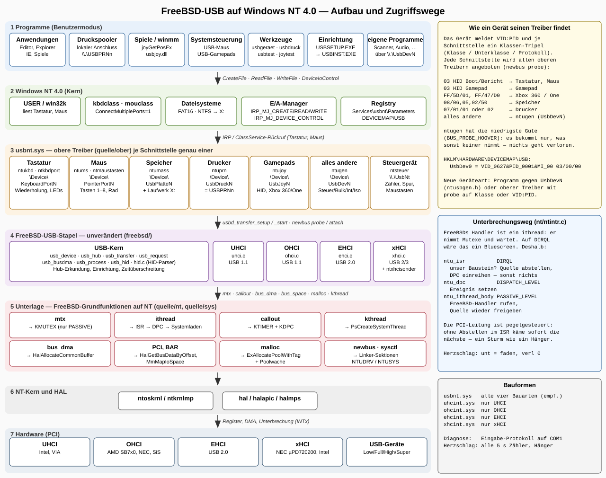

# FreeBSD-USB für Windows NT 4.0

Ein USB-Treiber für Windows NT 4.0. NT 4.0 kennt von sich aus gar kein USB.
Dieser Treiber bringt es nach: Tastaturen, Mäuse, USB-Sticks und Festplatten,
Drucker und Gamepads funktionieren damit an allen vier Arten von
USB-Controllern (USB 1.1 bis USB 3.0).

Das Besondere: Den eigentlichen USB-Teil habe ich nicht neu geschrieben. Es ist
der USB-Stapel von **FreeBSD**, unverändert übernommen. Darunter liegt eine
Schicht, die FreeBSDs Grundfunktionen (Sperren, Fäden, Unterbrechungen,
Speicher) auf die von NT 4.0 abbildet. Darüber sitzen kleine Treiber, die aus
USB-Geräten das machen, was Windows erwartet: eine Tastatur für `kbdclass`, ein
Laufwerk für den Explorer, einen Druckeranschluss für den Spooler.



Das Schema zeigt alle Schichten, von den Programmen oben bis zur Hardware unten,
und die Wege, auf denen Programme und andere Treiber zugreifen.

---

## Einrichten

**Voraussetzung:** Windows NT 4.0 mit Service Pack 6a, angemeldet als
Administrator.

### Mit dem Fenster

1. Den Ordner `installer` auf den NT-Rechner kopieren (zum Beispiel nach `C:\USBNT`).
2. `USBSETUP.EXE` doppelklicken.
3. **Einrichten** klicken, dann die Frage nach dem Neustart mit **Ja** beantworten.

Im Fenster lässt sich außerdem wählen:

| Einstellung | Bedeutung |
|---|---|
| Treiber | `USBNT` für alle Controller (empfohlen) oder eine Einzelbauform |
| Diagnoseausgabe | Meldungen des Treibers auf COM1, COM2 oder aus |
| Maustaste 4 / 5 | Belegung der Seitentasten (alle acht Tasten: Systemsteuerung → USB-Maus) |
| VirtualBox „3.0" | nur bei VirtualBox mit USB-3.0-Controller ankreuzen (siehe „Grenzen") |

**Ausprobieren** startet den Treiber einmal, ohne ihn fest einzutragen.
**Entfernen** nimmt alles wieder heraus.

### Mit der Befehlszeile

```
EINRICHT.BAT              einrichten (wie "Einrichten" im Fenster)
PROBE.BAT                 einmal ausprobieren
ENTFERNE.BAT              entfernen
USBINST                   Zustand anzeigen
USBINST ein xhci          nur die xHCI-Bauform einrichten
USBINST taste 4 strg+c    Maustaste 4 = Strg+C (wirkt sofort)
```

Die genaue Beschreibung aller Befehle steht in `installer/LIESMICH.TXT`.

---

## Was funktioniert

| Gerät | So erscheint es unter NT |
|---|---|
| **Tastatur** | wie eine normale Tastatur. Tastenwiederholung, Num/Caps/Scroll-LEDs |
| **Maus** | wie eine normale Maus, mit Rad. Tasten 1–8 frei belegbar |
| **USB-Stick, Festplatte, Kartenleser** | als Laufwerk (FAT16, NTFS), sicher auswerfen mit `USBGERAET auswerfen E:` |
| **Drucker** | als Anschluss `USBPRN1`, `USBPRN2`, …; im Druckermanager als „lokaler Anschluss" wählbar. Mit Rückkanal (Status, PJL) |
| **Gamepads** | HID-Gamepads, Xbox-360- und Xbox-One-Controller. Für Spiele über den Joystick-Treiber von Windows, mit Systemsteuerung „USB-Gamepads" |
| **alle anderen Geräte** | als rohes Gerät `\\.\UsbDev0`, `\\.\UsbDev1`, … – für eigene Programme (siehe unten) |

**Controller:** UHCI, OHCI (USB 1.1), EHCI (USB 2.0) und xHCI (USB 3.0),
darunter der **NEC µPD720200**. Geschwindigkeiten Low, Full, High und
SuperSpeed.

**Mehrprozessor:** geprüft mit dem Mehrprozessor-Kern `ntkrnlmp` auf zwei
Prozessoren. Eine NT 4.0 **Workstation** nutzt höchstens zwei Prozessoren,
auch auf einem Rechner mit mehr Kernen.

---

## Die Programme

| Programm | Wofür |
|---|---|
| `USBSETUP.EXE` | Einrichten mit Fenster |
| `USBINST.EXE` | Einrichten auf der Befehlszeile; Maustasten belegen |
| Systemsteuerung → **USB-Maus** | zeigt, welche Maustaste gerade gedrückt ist (1–8), und belegt jede davon – wirkt sofort |
| Systemsteuerung → **USB-Gamepads** | Gamepads ansehen und prüfen |
| `USBGERAET.EXE` | alle Geräte mit Kennung und Klasse auflisten, Deskriptoren lesen, Daten senden und empfangen, Laufwerke auswerfen |
| `USBDRUCK.EXE` | Drucker: Kennung, Status, Datei drucken, PJL-Abfrage |
| `JOYTEST.EXE` | Gamepads roh oder über Windows abfragen |
| `EINGABE.EXE` | messen, was an Tastatur- und Mauseingaben bei Windows ankommt |
| `USBTEST.EXE`, `XHCITEST.EXE` | Zähler, Controller-Register, Fehlersuche |

---

## Wie Geräte erkannt werden

Jedes USB-Gerät meldet beim Einstecken seine **Kennung** (Hersteller und
Produkt, „VID:PID") und für jede seiner **Schnittstellen** ein Klassen-Tripel
aus Klasse, Unterklasse und Protokoll. Ein Gerät kann mehrere Schnittstellen
haben – ein Multifunktionsdrucker etwa eine zum Drucken, eine zum Scannen und
eine für den Kartenleser.

Jede Schnittstelle wird allen Teiltreibern angeboten. Wer sie kennt, nimmt sie:

| Klassen-Tripel | Teiltreiber |
|---|---|
| 03 (HID), Tastatur/Maus | Tastatur, Maus |
| 03 (HID), Gamepad; FF/5D/01 (Xbox 360); FF/47/D0 (Xbox One) | Gamepad |
| 08 / 06, 05 oder 02 / 50 | Speicher |
| 07 / 01 / 01 oder 02 | Drucker |
| **alles andere** | rohes Gerät `UsbDevN` |

Der letzte Teiltreiber hat mit Absicht die niedrigste Priorität: Er bekommt nur,
was sonst keiner nimmt. **Es geht also kein Gerät verloren.** Welche Geräte da
sind, zeigt `USBGERAET`; sie stehen auch in der Registry unter
`HKLM\HARDWARE\DEVICEMAP\USB`, zum Beispiel:

```
\Device\UsbDev0 = "VID_04B8&PID_0101&MI_00 FF/FF/FF"
```

### Für neue Geräte etwas bauen

Für Geräte, die noch keinen eigenen Teiltreiber haben – Scanner, Soundkarten,
serielle Wandler –, gibt es zwei Wege:

1. **Ein Programm oder eine DLL über `\\.\UsbDevN`** (empfohlen). Mit
   `CreateFile` und `DeviceIoControl` lässt sich alles tun, was ein Treiber tut:
   Deskriptoren lesen, Steuer-, Bulk-, Interrupt- und isochrone Übertragungen,
   Einstellung wählen. Ein Fehler führt hier höchstens zu einem abstürzenden
   Programm, nicht zu einem Bluescreen. Die Schnittstelle steht vollständig in
   `quelle/ober/ntusbgen.h`, ein Beispiel ist `quelle/werkzeug/usbgeraet.c`.
   So funktionieren unter Linux auch libusb und die Scanner-Programme von SANE.
2. **Ein eigener Teiltreiber im Kern** – nötig, wenn Windows das Gerät über
   seine eigenen Wege sehen soll (als Laufwerk, als Tastatur, als
   Druckeranschluss). Vorlage: `quelle/ober/ntuprn.c`. Seine `probe`-Funktion
   prüft die Klasse oder eine Liste von VID:PID.

Hinweise zu den Gerätearten:

- **Scanner** haben meist keine Klasse (Herstellerklasse FF) und ein eigenes
  Protokoll. Erkennen lassen sie sich an VID:PID. Weg 1 mit einem SANE-Backend
  als Vorlage liegt nahe.
- **Soundkarten** (USB-Audio, Klasse 01) brauchen isochrone Übertragungen. Die
  sind vorhanden (`IOCTL_NTUG_ISO`), aber noch nicht mit einem echten
  Audiogerät geprüft. Für Windows bräuchte es einen Wave-Treiber für winmm, wie
  `USBJOY.DLL` für die Gamepads.
- **Drucker** der Klasse 07 gehen schon. „GDI-Drucker", die nur die Rasterdaten
  ihres Herstellers verstehen, brauchen zusätzlich einen passenden
  Druckertreiber – das ist aber keine USB-Frage mehr.

---

## Wenn etwas nicht geht

1. **Diagnoseausgabe einschalten** (im Fenster „COM1") und die Meldungen mit
   einem zweiten Rechner oder einem Nullmodemkabel mitschreiben. Der Treiber
   meldet dort jeden Controller, jedes Gerät und jeden Fehler.
2. **Diagnosebau** (`bin/diagnose/usbnt.sys`): schreibt zusätzlich jeden
   Tastatur- und Mausbericht mit.
3. **Herzschlag-Bau** (`bin/herzschlag/usbnt.sys`): meldet alle fünf Sekunden
   die Zähler (Unterbrechungen, verlorene Arbeit, Speicher) und jeden Faden,
   der hängt. Gut bei Hängern.

Beide Sonderbauten werden wie `usbnt.sys` eingesetzt (Datei ersetzen, neu
starten).

**Wichtig:** Immer nur **eine** Bauform einrichten. Laufen `usbnt` und zum
Beispiel `xhcint` gleichzeitig, programmieren zwei Treiber denselben Controller
– das führt zu Resets und Hängern. `USBINST` und `USBSETUP` verhindern das.

---

## Grenzen

- **Tastatur-LEDs und Wiederholrate mit PS/2 im Rechner:** Windows schickt
  beides nur an *eine* Tastatur, und das ist dann die PS/2-Seite. Die
  USB-LEDs folgen deshalb nur Tastendrücken auf USB-Tastaturen, und für die
  Wiederholrate gilt die Vorgabe des Treibers (30 je Sekunde nach 500 ms).
- **VirtualBox mit USB-Controller „3.0":** Es gibt einen gemeldeten Hänger.
  VirtualBox gibt sich als Intel-Controller aus, für den der Treiber einen
  besonderen Schrittmodus einschaltet. Das Häkchen „VirtualBox 3.0" im
  Einrichtungsfenster schaltet ihn ab. Ob das die Ursache ist, ist noch nicht
  auf VirtualBox bestätigt. Mit dem Controller „2.0" gibt es das Problem nicht.
- **Echte Hardware:** Fast alles ist unter der Nachbildung QEMU geprüft. Mit
  echten Controllern und Geräten ist nur ein Teil erprobt; offen ist
  insbesondere eine echte NEC-Karte.
- **Renesas µPD720201/720202** ohne eigenen Firmware-Speicher werden nicht
  unterstützt (diese Karten erwarten, dass der Treiber die Firmware lädt).
- **Mehr als zwei Prozessoren:** ungeprüft (Lizenzgrenze der Workstation).

Die vollständige Liste offener Punkte steht in `PRUEFLISTE.md`.

---

## Inhalt des Pakets

| Ordner / Datei | Inhalt |
|---|---|
| `installer/` | der Installer, fertig zum Kopieren auf den NT-Rechner |
| `bin/treiber/` | die fünf Bauformen `usbnt`, `uhcint`, `ohcint`, `ehcint`, `xhcint` |
| `bin/diagnose/`, `bin/herzschlag/` | die beiden Sonderbauten zur Fehlersuche |
| `bin/programme/`, `bin/systemsteuerung/` | alle Programme und Systemsteuerungs-Elemente |
| `quelle/` | eigener Quellcode: `nt/` Unterlage, `sys/` FreeBSD-Kopfdateien, `ober/` Teiltreiber, `werkzeug/` Programme |
| `freebsd/` | FreeBSDs USB-Stapel, unverändert (Herkunft in `freebsd/HERKUNFT.md`) |
| `ARCHITEKTUR.svg`, `schema/` | das Schema und das Skript, das es erzeugt |
| `KI-KONTEXT.md` | dieselbe Beschreibung für KI-Assistenten: knapp, vollständig, mit allen Schnittstellen |
| `GERAETE.md` | die rohe Geräteschnittstelle `UsbDevN` im Einzelnen |
| `DRUCKER-ANSCHLUSS.md` | die Druckerschnittstelle im Einzelnen |
| `AENDERUNGEN.md` | was sich wann und warum geändert hat |
| `PRUEFLISTE.md` | was geprüft ist und was noch offen ist |
| `pruefstand/` | die Werkzeuge, mit denen unter QEMU geprüft wurde |
| `bau-clangcl.sh`, `einfuhrlib.py`, `pruefsumme.py`, `ddk-ersatz/` | zum Bauen |
| `pruefe-bau.py` | nach jedem Bau: Abschnitte, PE-Prüfsumme, Versionsangabe, NT-4.0-fremde Importe |
| `bin/ungeprueft-2026.11.11.2/` | Neubau aus dem aktuellen Quellstand – gebaut und statisch geprüft, **nicht gelaufen** |
| `hid/` | HID für NT 4.0 (Beschreibung; Quellen in `quelle/werkzeug/hiddll.c`, `hidtest.c`) |
| `kernelpatch/` | freiwillige Ergänzung für einen selbst gebauten NT-Kern (erweitert dessen PCI-Suchlauf um USB-Angaben); der Treiber braucht sie nicht |

---

## Aus den Quellen bauen

Gebaut wird unter Linux mit **clang-cl** und **lld-link** gegen das
**NT-4.0-DDK** (das DDK ist nicht im Paket; es stammt von Microsoft):

```
DDK=/pfad/zum/ddk ./bau-clangcl.sh          # usbnt.sys, alle Bauarten
NUR=xhci DDK=... ./bau-clangcl.sh           # nur xHCI -> xhcint.sys
EXTRA=-DNTU_EINGABE_PROTOKOLL ...           # Diagnosebau
HERZ=1 ...                                  # Herzschlag-Bau
```

Die Programme werden mit **mingw-w64** (`i686-w64-mingw32-gcc`) gebaut, ohne
Laufzeitbibliothek; die Befehle stehen in `quelle/werkzeug/bauen.md`.

Die Dateien von FreeBSD tragen ihre BSD-Lizenz im Kopf.
